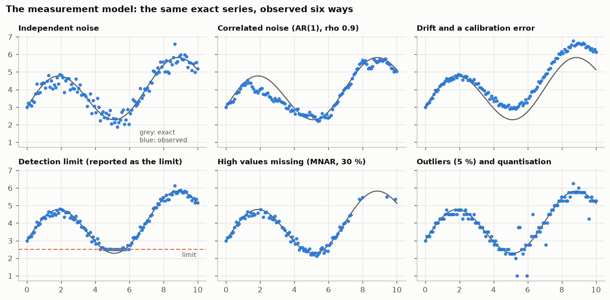
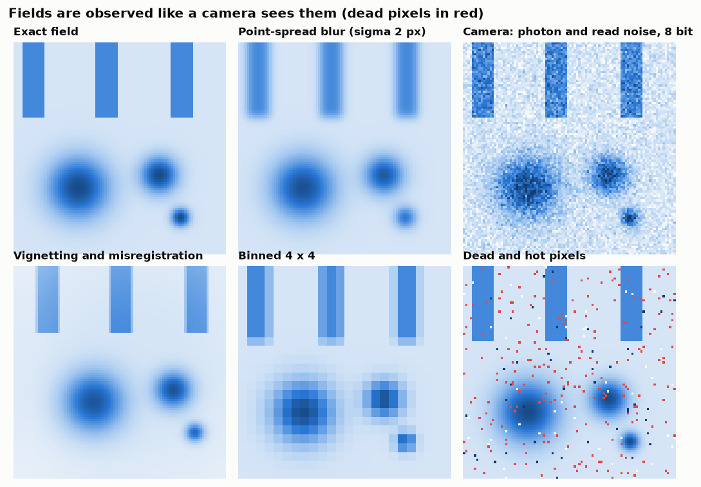
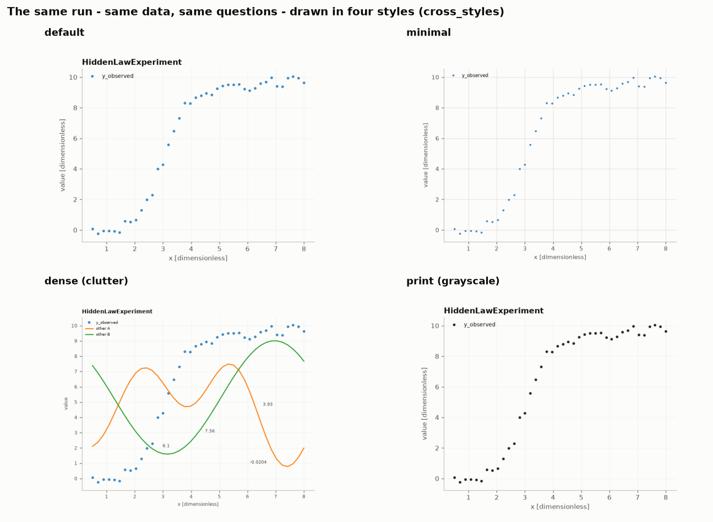
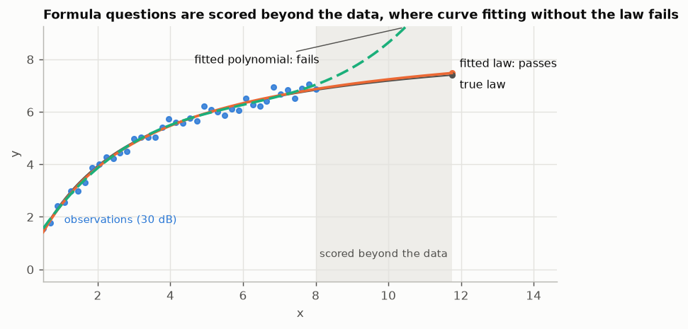
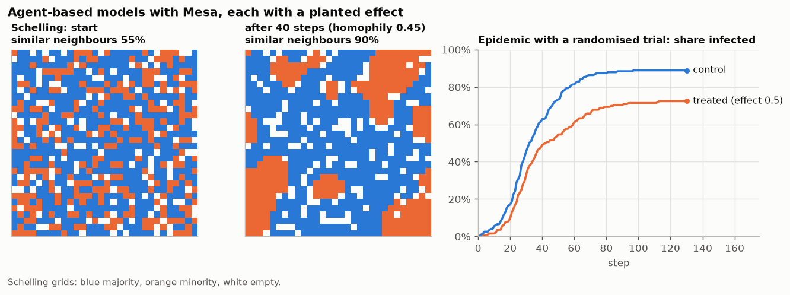
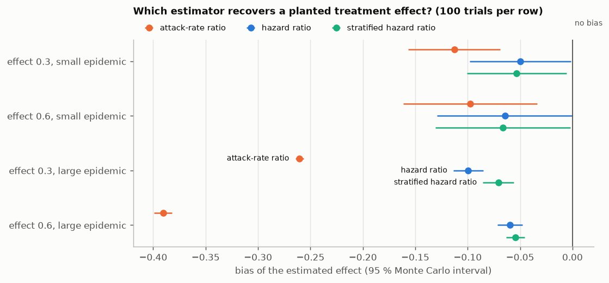

# Scientific Data Simulator

[](https://github.com/sandner-art/scientific-data-simulator/blob/main/LICENSE)
[](https://www.python.org/downloads/)
[](https://doi.org/10.5281/zenodo.24362513)
[](https://github.com/sandner-art/scientific-data-simulator/actions/workflows/tests.yml)

| Author: Daniel Sandner | Scientific Data Simulator (scidatasim): A Modular Testbed for Synthetic Scientific Data with Open or Hidden Ground Truth
- part of the **100 Scientific Visions** project (2025-2027)

## Overview

Scientific Data Simulator turns an executable scientific model into **reference data**: datasets whose generating mechanism, parameters and measurement process are known exactly and recorded with the data.

It is meant for situations where real data are unavailable, not yet available, or have no known ground truth:

- validating analysis methods, fitting code and inference pipelines;
- testing and training AI systems, including law discovery, parameter inference and noisy-data robustness;
- auditing benchmarks and datasets for leaks, shortcuts and contamination before they are published;
- teaching, and early-stage research before experiments exist.

The bundled models cover physics, geometry and mathematics, and, through the Mesa adapter, agent-based models in social science, epidemiology and economics.

The simulator does not try to be a general solver. It is an **observation-and-provenance layer** between a mechanism (yours, or a wrapped library) and whatever consumes the data.


## Features

* **Plug-in models.** A model is a small `ExperimentLogic` class (`initialize`, `run_step`, `get_results`). A YAML config names it by dotted path.
* **Seeded, recorded randomness.** Every run has one integer seed, either set in the config or drawn and then recorded. Independent random streams for the model and for observation noise are derived from it, so a stored config is a complete recipe for re-running.
* **Role-tagged outputs.** Each output is labelled `parameter`, `latent`, `label`, `observation`, `coordinate` or `auxiliary`.
* **Observation operators** turn exact (latent) outputs into realistic measurements without changing the mechanism:
  * sampling: every k-th step, n points, or explicit indices;
  * Gaussian noise (absolute `sigma` or `snr_db`), multiplicative and Poisson noise;
  * quantisation, outliers, missing values and clipping;
  * errors that are not independent per point: correlated (AR(1)) noise, instrument drift, a calibration error (gain and offset), detection limits with censoring, missing values that depend on the true value or on position, and timing jitter;
  * fields (images, stacks of frames): point-spread-function blur, a camera model (photon and read noise, saturation, ADC bits), pixel binning, vignetting and sub-pixel misregistration;
  * real noise: the simulated signal placed in a real measured background (a light curve, a stretch of detector data, an image), on its real time stamps with its real gaps, so the noise is real and the truth is still known.
* **Real data in, with provenance.** `scidatasim.ingest` reads CSV/ECSV/TSV, Parquet, JSON, NPY/NPZ, HDF5 and FITS (with the `astro` extra) and records each file's path, SHA-256 and the rows used. The `external` experiment serves a measured series as a run's observation, so real and simulated data go through the same questions, estimators and reports.

  Every setting is recorded, including noise levels derived from an SNR, outlier positions and the drawn calibration error.

  


  
* **Ground truth exported separately.** `ground_truth.json` and `data/ground_truth/` hold the answers, while `data/observation/` holds what a method under test gets to see.
* **Counterfactual law shifts.** `law_shift:` changes a constant or swaps a functional form, recording both the original and the shifted law. Benchmarks built this way cannot be answered from memorised textbook equations.
* **Provenance in every record:**
  * config SHA-256, and the model's source-file SHA-256, git commit and dirty flag;
  * simulator and dependency versions, system info and a `synthetic` flag;
  * a SHA-256 for every data file. Checksums are verified on load.
* **Data files instead of inline JSON.** Arrays are written as `.npy` (or one HDF5 file) and DataFrames as Parquet or CSV, grouped by role. Arrays can be memory-mapped when loaded.
* **Design of experiments.** Full-factorial, Latin hypercube, Sobol, Halton and random designs (linear or log scale, integer parameters). Designs support replicates, per-row or common-random-number seeds, dotted keys for nested settings (e.g. sweeping `observation.operators.0.snr_db`), parallel workers, and a tidy results table with one row per run.
* **Verified reference models.** The bundled models are checked against closed forms, high-accuracy solvers, convergence orders and conserved quantities (`tests/test_verification.py`).
* **Multimodal run bundles.** With `bundle: true`, one run also writes, all derived from the same arrays and seed:
  * the figure, rendered by executing the shipped `plot_figure.py`, so code and image cannot disagree;
  * the plotted data as `table.csv`;
  * a caption that reveals no answers;
  * questions with answers and tolerances computed from the exact curves (peaks, extremes, values, comparisons, parameter estimates);
  * the mechanism graph (JSON and Graphviz).

  Models that describe a diagram (`figure_elements()`) get a geometric drawing instead of a chart, and can add their own exact questions (`questions()`). Files are marked public (what a system under test sees) or private (the answers and the numeric tolerances, which would reveal them). Hiding the exact curves (`show_latent: false`) turns figure-reading questions into inference questions. A design collects all of its runs' questions into `questions.jsonl` (public) and `qa.jsonl` (private).

  Figure style and clutter are design factors: presets (`default`, `minimal`, `dense`, `print`, `presentation`) and knobs for palette (including grayscale and colour-blind safe), line and marker size, font size, log axes, tick density, legend placement, unrelated curves and stray numbers on the chart. `scidatasim.doe.cross_styles` draws every run of a design in several styles with the same seed, so data, questions and answers stay identical and only the picture changes; `scidatasim.diagnostics.style_gap` then measures a vision-language model's accuracy per style on matched items, separating perception errors from reasoning errors.

  
* **Model fidelity labels.** Every model declares a fidelity level with a short reason, recorded in each run (see [Model fidelity](#model-fidelity-reference-and-deliberately-weak-models)).
* **Exporters** (`scidatasim.export`):
  * questions as scored tasks (`tasks.jsonl`);
  * Hugging Face dataset folders with a dataset card and Croissant 1.0 metadata (validated with `mlcroissant`, loadable with `datasets`);
  * (θ, x) training sets and a batch simulator for simulation-based inference (`sbi`);
  * OpenEnv environment packages and verifiers tasksets for reinforcement learning.

  Ground truth is withheld unless you ask for it.
* **Interactive discovery environments** (`scidatasim.envs`). An agent runs a limited number of noisy experiments on a system with hidden parameters, then reports an estimate, which is scored automatically. It has a Gymnasium-style `reset`/`step`/`state` API and no dependencies.
* **Physical units** (optional `pint`). Parameters can be given with units (`stiffness: "2 kN/m"`) and are converted to the model's declared units. Output units are checked, including traps such as `units` (pint reads it as *micronit*) and `au` (astronomical unit).
* **Model checker** (`scidatasim.checker`). A gate for new and LLM-written models:
  * a static scan of the source;
  * determinism and untouched global random state;
  * finite outputs;
  * convergence order when `dt` is halved;
  * invariant drift;
  * dead parameters;
  * units.

  `scidatasim.llm.draft_model` asks any LLM for a model, runs the checker in a separate time-limited process, and retries with the findings.
* **Law discovery** (`scidatasim.experiments.law_discovery`). Hidden laws y = f(x) from nine families (power law, inverse power, exponential decay, logistic, Michaelis–Menten, Hill, damped oscillation, Gaussian peak, Arrhenius), each with a textbook or a *counterfactual* setting of its structural constants (e.g. an inverse-*2.3* law). Formula answers are scored by evaluating them on the data range and half of it beyond (`scidatasim.expressions`: a safe parser with no `eval`), so any equivalent form counts but a polynomial that only reproduces the observed curve does not; the tolerance follows the run's noise. A suite design, a classical curve-fitting baseline and an interactive formula-discovery environment come with it (example 10). Example 13 builds a frozen release of the suite to publish and cite.

  
* **Leak audit** (`scidatasim.audit`). Before publishing, attack your own export: it tries seed replay, config-hash lookup, tolerance inversion, answer lookup in public files and exposure of hidden arrays, using the private runs as the answer key, and reports what would leak. Near matches are reported with the count expected by chance, so coincidences among many noisy numbers do not refuse a release (`tools/check_audit_calibration.py` measures false alarms and leaks caught). `audit_environment` does the same for interactive environments.
* **Agent-based models with Mesa** (`scidatasim.adapters.mesa`, example 15). Any [Mesa](https://mesa.readthedocs.io) model runs under the simulator's seeds, roles, observation operators, bundles, designs, audits and simulation studies, without being rewritten. A pack of three Mesa models with a planted effect covers social science (Schelling segregation), epidemiology and causal inference (an epidemic with a randomised trial inside it) and economics (wealth exchange with saving). `pip install "scidatasim[mesa]"`.

  
* **Simulation studies** (`scidatasim.ademp`, example 14). Compare statistical methods on data with a known truth, in the ADEMP structure (aims, data-generating mechanisms, estimands, methods, performance measures): bias, empirical SE, MSE, coverage, model-SE error and rejection rate, each with its Monte Carlo standard error; methods see only the observations; every repetition's seed is recorded.

  
* **Testbed diagnostics** (`scidatasim.diagnostics`, example 11). Because every hidden value is known and every run can be regenerated, the simulator can test benchmarks and agents: blind and metadata-only baselines (shortcut artefacts), a fitted-polynomial baseline for formula questions (scorer loopholes), a quality card (answer balance, position bias, duplicates), fresh twins and paired gap tests (contamination), canaries and canary probes, and agent-fallacy flags for interactive episodes (answering without evidence, ignoring one's own data, preferring a textbook law to the counterfactual one, narrow sampling, repeated experiments).
* **Language models in defined roles** (`scidatasim.ai`, example 12). A model can play the agent in an environment, attack a release, rephrase questions or answer them. Every call is logged (role, model, settings, prompt, output) and can be replayed without the model. Rephrased questions are accepted only if they keep the numbers and options and add no answer. Answers always come from the simulator.
* **Automatic plots.** matplotlib PNG, and interactive Plotly HTML with the `interactive-plots` extra, driven by output descriptors; observed points are drawn over the latent curves. Static SVG/PDF export of Plotly figures needs the optional `kaleido` package. The figures in this README are made by `tools/make_readme_figures.py`.

### Planned

* Multi-variable and dynamical (ODE) law discovery; symbolic-regression baselines (e.g. PySR) as optional comparisons.
* 3-D solids beyond the tetrahedron; dihedral angles.
* Adapters: Exponax (PDE), FMPy (FMI models), MLflow/DVC tracking; ingest adapters for external simulators (GalSim, multislice codes).
* Generic inputs for the leak audit (any answer key) and the fallacy flags (any labelling log); metadata scanning of image and audio files.

## Installation

Python 3.11 or newer is required. Install the simulator into its own environment, which the
install scripts do for you. In an environment shared with other projects, pip may change
packages those projects need (for example, downgrade Pillow). The install scripts create a
virtual environment in `.venv`, install a profile and run `sds doctor`, which checks the
installation and says how to fix what is missing.

| System | Install | Update |
|---|---|---|
| Windows (cmd or double-click) | `scripts\install.cmd [profile]` | `scripts\update.cmd` |
| Windows (PowerShell) | `scripts\install.cmd standard`, or `.\scripts\install.ps1 -Setup standard` if scripts are allowed | `scripts\update.cmd` |
| Linux, macOS | `bash scripts/install.sh [profile]` | `bash scripts/update.sh` |

Profiles: `core` (simulate, CSV/NPY storage, PNG plots), `standard` (the default: adds interactive
HTML plots and their static export, Parquet, HDF5 and physical units), `all` (adds dataset validation: mlcroissant and
datasets), `dev` (standard plus the test tools) and `ui` (standard plus the browser UI).
The update scripts pull the latest code if the folder is a git checkout on a branch with an
upstream, then reinstall the profile chosen at install time.

By hand, on any system:

```bash
python -m venv .venv
source .venv/bin/activate          # Windows: .venv\Scripts\activate
pip install -e ".[standard]"       # or: pip install -e .   /   ".[dev]"
sds doctor
```

From PyPI, without a checkout (release candidates need `--pre`):

```bash
pip install --pre "scidatasim[standard]"     # the browser UI: pip install --pre scidatasim-ui
sds doctor
```

macOS: use a Python from python.org, Homebrew or uv, not the system one. On every system,
static PNG/SVG/PDF export of plotly figures needs Chrome; `plotly_get_chrome` downloads one
(interactive HTML plots work without it). The CI workflow tests on Linux (Python 3.11-3.14),
Windows and macOS, and runs the install scripts on all three as a new user would. Keep one
`.venv` per system: a Windows `.venv` cannot be used from WSL, and the reverse.

Optional extras (the profiles combine them):

| Extra | Adds |
|---|---|
| `interactive-plots` | plotly ≥ 6.1.1, for interactive HTML plots |
| `static-plots` | kaleido and plotly ≥ 6.1.1. Static SVG/PDF export also needs Chrome. |
| `mesa` | Mesa ≥ 3.0, for agent-based models (the adapter and the social pack) |
| `parquet`, `huggingface` | pyarrow |
| `hdf5` | h5py |
| `the-well` | h5py and PyYAML, to write The Well HDF5 (loading it needs `the_well` and PyTorch) |
| `units` | pint |
| `validate` | mlcroissant and datasets, to check exported datasets |
| `openenv` | the OpenEnv library, to use exported RL packages |
| `verifiers` | the verifiers library, to use exported RL packages |
| `standard` | static-plots, parquet, hdf5 and units |
| `all` | `standard` plus validate and mesa |

Install `openenv` and `verifiers` in separate environments: their current releases pin incompatible versions of `mcp`.

## Quick start

Examples are listed, explained and run by the `sds` command (also `python -m scidatasim`):

```bash
sds examples list                      # title, level, fields, runtime
sds examples show example_10_law_discovery
sds examples run example_8_geometry_benchmark --quick
sds examples run example_10_law_discovery --set export=true --output my_run
```

Prefer a browser? Install the `ui` profile (`bash scripts/install.sh ui`, Windows:
`scripts\install.cmd ui`) and start it with `sds ui`. It shows the examples, a run form with
a live log, past results and the installation check. It is a separate package in `ui/` (see
`ui/README.md`) that uses the same functions as the command line.

Each run goes to its own folder (default `sds_runs/<example>/<time>`), with `run.log` and
`run.json`; `run.json` holds the exact command, so any run can be repeated in a script. An
example is described by the `example.yaml` in its folder (see `examples/README.md`); tools
read these manifests, so a new example appears in `sds examples list` once it has one.

Or directly:

```bash
python -m examples.example_1.run_experiment                       # sine wave
python -m examples.example_7_reference_dataset.run_experiment     # reference dataset with noise sweep
pytest                                                            # full test suite
```

A minimal config:

```yaml
experiment_type: scidatasim.experiments.predator_prey.logic.PredatorPreyExperiment
seed: 42
n_steps: 3000
dt: 0.01
integrator: rk4
clamp_negative: false
initial_prey: 10.0
initial_predators: 5.0
prey_growth_rate: 1.1
prey_death_rate: 0.4
predator_growth_rate: 0.1
predator_death_rate: 0.4

observation:                    # optional measurement model
  sampling: {every: 25}
  operators:
    - {type: gaussian, snr_db: 20}
    - {type: missing, rate: 0.05}

law_shift:                      # optional counterfactual law
  changes: {functional_response: holling2, handling_time: 0.3}
  description: saturating predation

storage: {format: npy}          # npy (default) | hdf5 | inline
bundle: true                    # figure + code + table + caption + Q&A + graph
```

From Python:

```python
from scidatasim.engine import SimulatorEngine
from scidatasim.doe import create_doe_table, run_design

engine = SimulatorEngine(output_dir="experiments_output")
run = engine.run_config(config)                 # or engine.run_experiment("config.yaml")
run.record.ground_truth["parameters"]           # the answers
run.results["prey_population_observed"]["data"] # what a method gets to see

design = create_doe_table({"prey_growth_rate": [0.8, 1.4],
                           "observation.operators.0.snr_db": [10, 40]},
                          design_type="lhs", n_samples=32, seed=1)
out = run_design(config, design, output_dir="lhs_study", replicates=5, n_jobs=4)
out.table      # design + seed + experiment_id + scalar outputs, one row per run
```

With `n_jobs > 1`, scripts must put this code under `if __name__ == "__main__":` because worker processes re-import the main module.

## Model fidelity: reference and deliberately weak models

Not every bundled model is meant to be correct. Some are kept, or will be added, as **deliberately weak models**: they are numerically or structurally flawed in a known, documented way, so that you can test whether a fitting method, an AI system or a validation pipeline *notices* model error. To keep this transparent, every model declares a fidelity level and a reason. The engine records it in `provenance.fidelity` and `ground_truth.json`, writes it into each bundle's `description.md`, and logs a warning for `audit` and `unverified` runs.

| Level | Meaning |
|---|---|
| `reference` | Verified against closed forms, high-accuracy solvers, convergence orders or invariants (see `tests/test_verification.py`). |
| `audit` | Deliberately simplified or flawed. Use it to test whether a method notices model error; do not use it as ground truth for the real system. |
| `unverified` | No verification tests, or outside the verified range. Not reference data. |
| `observed` | Outputs come from loaded real data, not from a simulation. |

**Lotka–Volterra.** The predator–prey model's default configuration (`integrator: euler`, `dt: 1`, clamping of negative populations) reproduces version 0.1.0. It is labelled `audit`: forward Euler at this step size carries first-order integrator error and violates the conserved Lotka–Volterra quantity by more than 1 %. Use `integrator: rk4` with `dt ≤ 0.04` for `reference` data; larger steps are labelled `unverified`.

**Oscillator.** `integrator: euler` is the second deliberately weak model. Explicit Euler adds energy to an undamped oscillator at every step, so its amplitude grows; it is labelled `audit`. The closed-form (`exact`) and DOP853 options are `reference`.

**Pendulum.** `approximation: small_angle` replaces sin θ by θ. The solution is exact, but of the wrong equation: a *model-form* error, not a numerical one. Its period does not depend on amplitude and is 7 % short at 60° and 15 % short at 90°; the fidelity note states the error for the configured amplitude. The nonlinear DOP853 solution is `reference` (period checked against the elliptic-integral formula).

**Random walk.** `generator: randu` draws the coin flips from RANDU, IBM's notorious linear congruential generator, whose consecutive triples lie on 15 planes. Means and variances look normal; the raw uniforms are stored (`uniforms`, auxiliary) so that randomness diagnostics can find the defect.

**Heat equation.** `integrator: ftcs` is explicit finite differences. It is labelled `audit`: first order in time, second in space, and *unstable* above the stability limit (the fidelity note then says so and gives the growth factor). The spectral `exact` solution is `reference`.

All audit models have pinning tests (`tests/test_audit_models.py`, `tests/test_heat_and_the_well.py`) that check the flaw is still there and still the size documented.

A model sets its level with the class attributes `fidelity_level` and `fidelity_note`, or overrides `fidelity(config)` when the level depends on the configuration. The model checker never promotes a model to `reference`: that needs verification tests against independent knowledge.

## Exporting and using the data

```python
from scidatasim.export.tasks import collect_bundle_tasks, write_tasks_jsonl, score
from scidatasim.export.huggingface import export_huggingface
from scidatasim.export.sbi import generate_training_data
from scidatasim.export.rl import export_openenv, export_verifiers_qa
from scidatasim.export.the_well import export_the_well
from scidatasim.audit import audit_export

tasks = collect_bundle_tasks("experiments_output/my_design")          # questions from bundles
write_tasks_jsonl(tasks, "tasks.jsonl")                              # public (no answers)
score(tasks[0], "The maximum is about 13.7")                         # 1.0 or 0.0

export_huggingface("experiments_output/my_design", "hf_dataset", name="my-benchmark")
data = generate_training_data(config, {"prey_growth_rate": [0.6, 1.6]}, n=1000, seed=1)  # theta, x
export_openenv("examples/example_9_discovery_env/env.yaml", "rl/", name="lv_discovery")
export_verifiers_qa(tasks, "rl/", name="lv_figure_qa")
export_the_well("experiments_output/heat_design", "well/", dataset_name="sds_heat")  # PDE fields

print(audit_export("hf_dataset", "experiments_output/my_design").summary())  # PASS / FAIL
```

Ground truth stays private by default:
- The Hugging Face export omits latent and label arrays, `ground_truth.json`, run configurations, answers and numeric tolerances.
- `include_seeds=False` also withholds seeds, since a seed plus the simulator regenerates the data.

Run the leak audit (`audit_export`, or `python -m scidatasim.audit PUBLIC --private RUNS`) on anything you publish. It reports, per attack, how many hidden answers it recovered: published seeds (seed replay), config hashes, numeric tolerances that are a fixed fraction of the answer, answers that appear in public tables or text (exactly, rounded to 4 or more digits, or as a formula with other spacing), hidden arrays (noise-free curves) found among public numbers, and public design-point indices. It reads JSON/JSONL, CSV, Parquet, NumPy and HDF5 files and text; a file it cannot read is itself a failure, because it cannot be cleared. It exits with status 1 on a high-severity finding, so it can gate a release. It finds the known kinds of shortcut only: passing it is necessary, not sufficient.

The Well export writes HDF5 files in the schema of [The Well](https://github.com/PolymathicAI/the_well) (fields `t0_fields/u`, dimensions, periodic boundary conditions, scalars, `stats.yaml`), loadable with `the_well.data.WellDataset(path=...)`.

The OpenEnv package serves the interactive environment over HTTP/WebSocket and passes `openenv validate`. Use a WebSocket session for multi-step episodes: plain HTTP `/step` calls are stateless. The verifiers taskset scores answers with `score`, and verifiers' `openenv` taskset can drive the OpenEnv package for multi-turn training.

## Checking a model (and drafting one with an LLM)

```bash
python -m scidatasim.checker scidatasim.experiments.oscillator.logic.OscillatorExperiment config.yaml --markdown check.md
```

```python
from scidatasim.llm import CallableLLMClient, draft_model
draft = draft_model(CallableLLMClient(my_llm_function), "A pendulum with linear drag ...", config)
if draft.accepted:
    draft.save("scidatasim/experiments/drag_pendulum/logic.py")      # writes logic_check.md next to it
```

`my_llm_function(prompt) -> text` wraps any provider SDK; the simulator itself depends on none. Generated code is scanned before it runs, then checked in a separate process with a time limit. Rejected drafts cannot be saved.

## Reproducing the checks

The numbers in the changelog and in the verification notes come from three scripts in `tools/`. Run them from the repository root; each writes a JSON file and a Markdown table to `experiments_output/<name>/`. To compare two versions (before and after a fix), run the same script in two checkouts.

| Script | What it measures | Time (2 cores) |
|---|---|---|
| `tools/check_formula_scoring.py` | A BIC polynomial against the right law on the law-discovery formula question, under the rc1 rule (data range, 1 %) and the current one; 9 families x textbook/counterfactual x 3 noise levels x 40 draws | 4 min |
| `tools/check_env_tolerance.py` | The same in the interactive environment, fixed 2 % against `tolerance: auto`, at 40, 30, 20 and 15 dB | 3 min |
| `tools/study_extrapolation_scoring.py` | How to score the extrapolation question: blind and naive answers (0, best constant, last value, a line through the tail), a polynomial, the law fit and a fit of the true family, under four scoring rules and three distances beyond the data; which items discriminate | 30 min |
| `tools/check_audit_calibration.py` | The leak audit: false alarms on clean releases, and planted leaks of each kind caught (copies, float32, printed, recomputed, and two known blind spots). Builds quick releases of example 13 with fixed seeds; `--reuse` audits them again under another version | 20 min for 100 releases |
| `tools/check_astrometry_detection.py` | Astrometric binaries: false alarms of the detection baseline on single stars against the nominal FAP; detection, period recovery and AGIS weights by non-centrality; the parallax question by period; the private labels | 15 min |
| `tools/preregister_gaia_dr4.py` | Builds the Gaia DR4 pre-registration record (selection, method, simulated predictions, hypotheses, file hashes); `--verify` checks a record against the checkout | 40 min |
| `tools/gaia_dr4_fetch.py` | Fetches the pre-registered Gaia DR4 sample (selection, auxiliary rows, epoch astrometry) with a manifest of SHA-256 sums; needs astroquery | depends on the archive |
| `tools/gaia_dr4_analyze.py` | Runs the pre-registered analysis (H1–H5, E1–E4) on the fetched data and writes a report | about an hour on 8 cores |

Results at 0.7.0rc2:

- **Formula scoring (2,160 runs).** A polynomial passes 62 %, 61 % and 0 % of formula questions (noise-free, 40 dB, 20 dB) under the rc1 rule, and 5 %, 3 % and 9 % now; the right law passes 99 % at 40 dB and 81 % at 20 dB (9 % under the rc1 rule). Power laws remain within a polynomial's reach (29-69 %), so their items carry the `polynomial_reachable` label.
- **Environment (40 episodes per level).** At 40 and 30 dB `auto` stays at 2 % and changes nothing. At 15 dB the right law passes 78 % instead of 30 %, and a polynomial 22 % instead of 0 %: under that noise the data no longer separate them on the scored range.
- **Extrapolation question (2,160 runs).** Under the 0.7.0rc2 rule the answer 0 passed 34 % of the questions and the last observed value 57 %; only 17 % of items passed with a fit of the true law and failed every blind and naive answer. The rule since (half the range beyond the data, within 5 % or what a fit of the true law reaches there under the run's noise) gives 60 %; 0 passes 5 %. Plateaus (logistic, Hill, Michaelis-Menten, Arrhenius) still pass with the last observed value: a private `naive_reachable` label marks them.
- **Leak audit (221 quick releases).** The rule before 0.7.0rc2 refused 3 clean releases (1.4 %): two noisy observations within 1e-6 of an answer by chance, and one answer equal to its question's own x at 4 digits. Now none is refused; the two chance matches appear as medium-severity notes. Every planted copy is still caught (exact, round-off, float32, printed with 4 or more digits). Three answers recomputed with an error of 1e-9 to 1e-6 still refuse the release; a single one is a medium note, because one match that close cannot be told from chance.

## Writing a model

```python
from scidatasim.base import ExperimentLogic
from scidatasim.utils import DataDescriptor, DataType
import numpy as np

class Decay(ExperimentLogic):
    def __init__(self, config):
        self.k, self.n = config["k"], config["n_steps"]

    def initialize(self, config):
        self.t, self.x = [0.0], [1.0]
        return {"x": 1.0}

    def run_step(self, state, step):
        x = state["x"] * np.exp(-self.k) + 0.01 * self.rng.normal()  # always use self.rng
        self.t.append(step + 1.0); self.x.append(x)
        return {"x": x}

    def get_results(self):
        return {
            "t": {"data": np.array(self.t), "descriptor": DataDescriptor("t", DataType.NDARRAY, role="coordinate")},
            "x": {"data": np.array(self.x), "descriptor": DataDescriptor(
                "x", DataType.NDARRAY, x_axis="t", group="time_series", plot_type="line", role="latent")},
        }
```

Stochastic models must draw random numbers from `self.rng`, never from the global `np.random`. Override `ground_truth_parameters(config)` to export derived parameters.

## Output of a run

```
experiments_output/<timestamp>_<experiment_id>/
├── experiment_record.json   config, seed, provenance, descriptors, data-file manifest (sha256)
├── ground_truth.json        parameters, law shift, realised observation model, field roles
├── data/ground_truth/       latent / parameter / label arrays
├── data/observation/        observed arrays
├── data/coordinate/         time / x axes
├── data/auxiliary/          everything else
├── bundle/                  (with bundle:) figure, plot_figure.py, table.csv, caption.txt,
│                            questions.json | qa.json, graph.json/.dot, description.md, bundle.json
└── *_matplotlib.png, *_plotly.html
```

## Bundled models

| Model | Path | Notes |
|---|---|---|
| Sine wave | `scidatasim.experiments.example_experiment.logic.ExampleExperiment` | `reference`: closed form |
| Random walk | `scidatasim.experiments.example_random_walk.logic.RandomWalkExperiment` | `reference`: seeded; increment statistics tested. `audit` with `generator: randu`. |
| Linear function | `scidatasim.experiments.linear_function.logic.LinearFunctionExperiment` | `reference`: closed form |
| Lotka–Volterra | `scidatasim.experiments.predator_prey.logic.PredatorPreyExperiment` | `reference` with `integrator: rk4`, `dt ≤ 0.04`; `audit` with the 0.1.0 default (forward Euler, dt = 1). Options: `holling2`, logistic prey. |
| Oscillator | `scidatasim.experiments.oscillator.logic.OscillatorExperiment` | SI units. `reference`: closed form (linear) or DOP853 (Duffing cubic term); `audit` with `integrator: euler`. |
| Pendulum | `scidatasim.experiments.pendulum.logic.PendulumExperiment` | SI units. `reference`: nonlinear, DOP853; `audit` with `approximation: small_angle`. |
| Heat equation | `scidatasim.experiments.heat.logic.HeatExperiment` | 1-D/2-D periodic. `reference`: spectral exact solution; `audit` with `integrator: ftcs`. Export to The Well HDF5. |
| Hidden laws | `scidatasim.experiments.law_discovery.logic.HiddenLawExperiment` | `reference`: closed forms; nine families, textbook or counterfactual constants; formula questions. |
| Triangle geometry | `scidatasim.experiments.geometry.logic.TriangleExperiment` | `reference`: exact constructions (circumcircle, incircle, centroid, orthocentre, medians, altitudes, Euler line); diagrams and questions in bundles. |
| Polygons | `scidatasim.experiments.geometry.polygons.PolygonExperiment` | `reference`: regular, convex or simple polygons; area, centroid, angles, convexity, reflex corners. |
| n-simplex | `scidatasim.experiments.geometry.simplex.SimplexExperiment` | `reference`: simplices in 2–6 dimensions; volume (Cayley–Menger checked), facets, circum- and in-sphere; projected diagrams. |
| Calibration overlay | `scidatasim.experiments.predator_prey_calibration.logic.PredatorPreyCalibrationExperiment` | overlays observed CSV data (manual calibration); fidelity as for Lotka–Volterra |
| CSV summary | `scidatasim.experiments.data_analysis.logic.DataAnalysisExperiment` | `observed`: real data, recorded as `synthetic: false` |
| Segregation (Mesa) | `scidatasim.experiments.social.logic.SegregationExperiment` | `reference`: Schelling; planted homophily; agents conserved, no moves at homophily 0 |
| Epidemic trial (Mesa) | `scidatasim.experiments.social.logic.EpidemicTrialExperiment` | `reference`: SIR with a randomised trial; planted treatment effect; S + I + R and arms conserved |
| Wealth exchange (Mesa) | `scidatasim.experiments.social.logic.WealthExchangeExperiment` | `reference`: kinetic exchange with saving; wealth conserved; Gini checked against the Gamma law |
| Any Mesa model | `scidatasim.adapters.mesa.MesaExperiment` | `unverified`: wraps a Mesa model given by dotted path, with reporters and snapshots |

## Project structure

```
scidatasim/       engine.py, base.py, config.py, schema.py, rng.py, observation.py,
                  bundle.py, storage.py, persistence.py, provenance.py, experiment_record.py,
                  doe.py, data_handler.py, visualization.py, utils.py,
                  envs.py, units.py, checker.py, llm.py, expressions.py, audit.py,
                  ademp.py (simulation studies),
                  cli.py (the sds command), doctor.py, examples.py (example manifests),
                  export/ (tasks, huggingface, sbi, rl, the_well),
                  diagnostics/ (shortcuts, contamination, episodes, quality, perception, stats),
                  ai/ (clients, agent, attacker, writer, solver),
                  adapters/ (mesa),
                  experiments/ (bundled reference models, one package per model; social/ uses Mesa)
examples/         runnable examples, each with an example.yaml manifest (sds examples list)
scripts/          install, update and start-ui scripts for Windows (cmd, PowerShell), Linux and macOS
ui/               the browser UI: a separate package (scidatasim-ui), sds ui
tests/            pytest suite, incl. test_verification.py (numerical verification)
docs/             Sphinx sources; images/ holds the README figures
tools/            make_readme_figures.py (regenerates docs/images), ci_failures.py (CI summary),
                  check_*.py (the checks behind the verification notes; see Reproducing the checks)
```

## Citation

If you use Scientific Data Simulator in your research, please cite it:

> Sandner, D. (2026). Scientific Data Simulator (scidatasim): A Modular Testbed for Synthetic Scientific Data with Open or Hidden Ground Truth (Version 0.7.0) [Computer software]. Zenodo. https://doi.org/10.5281/zenodo.24362514

Cite the version you used: each release has its own DOI, listed on the [Zenodo record](https://doi.org/10.5281/zenodo.24362513) (this DOI always resolves to the latest version). Results record the version that produced them.

Full citation metadata is in [`CITATION.cff`](https://github.com/sandner-art/scientific-data-simulator/blob/main/CITATION.cff).

## License

Apache License 2.0. See [LICENSE](https://github.com/sandner-art/scientific-data-simulator/blob/main/LICENSE) and [NOTICE](https://github.com/sandner-art/scientific-data-simulator/blob/main/NOTICE).
